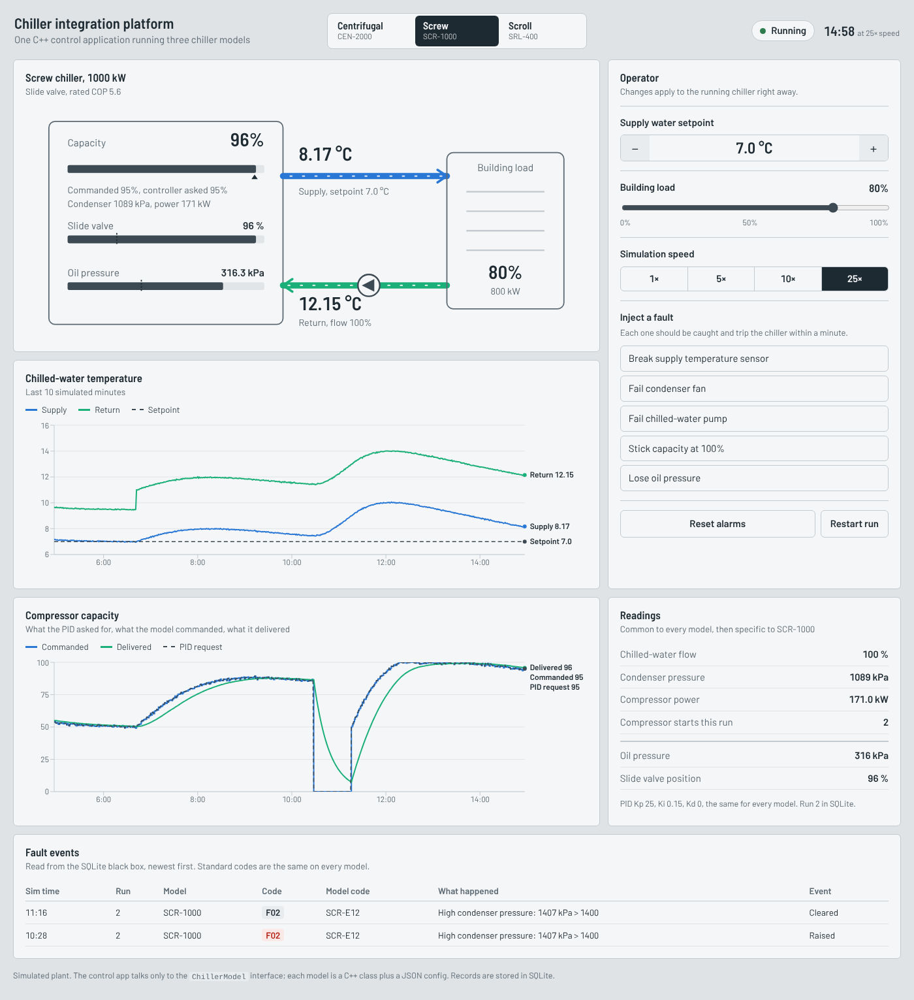
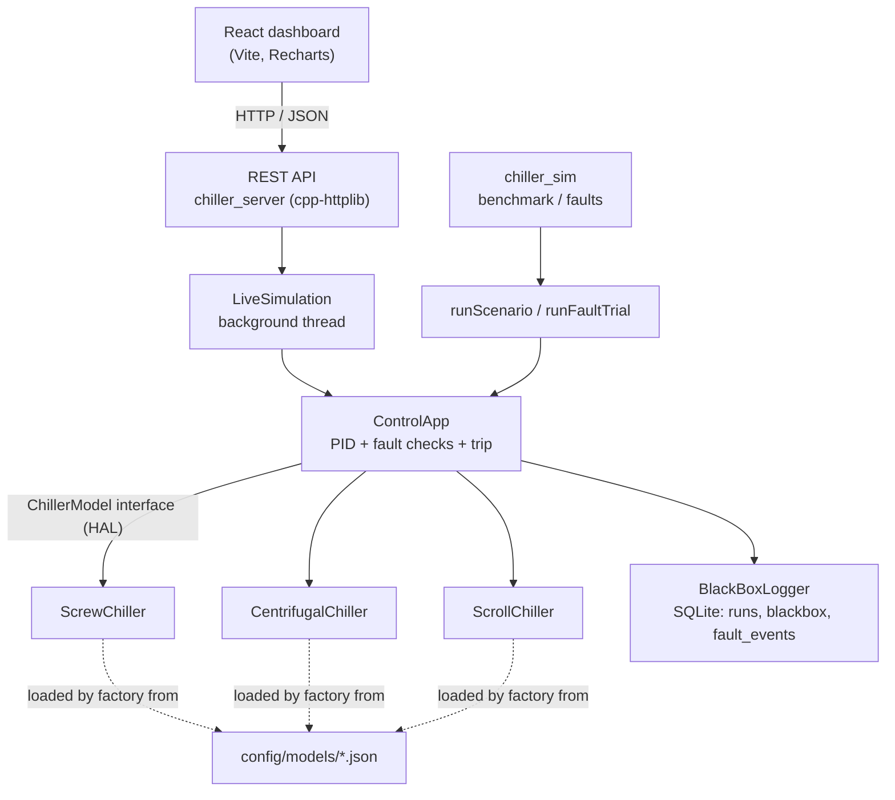

# Multi-Model Chiller Integration Platform

One C++17 control application that runs **unchanged** on three different simulated chiller models: screw, centrifugal and scroll. A hardware abstraction layer (HAL) hides how each model delivers capacity, every model writes the same standardized black-box record to SQLite, and a React dashboard shows the plant live through a REST API.



*The dashboard during a run on the screw model: the building load stepped from 50 % to 80 %, a condenser fan failure was injected, detected (F02 / SCR-E12), tripped the chiller, and was reset.*

## What it does

- **One control app, three models.** `ControlApp` (PID loop for chilled-water supply temperature) only talks to the `ChillerModel` interface. Screw, centrifugal and scroll chillers each implement it differently: slide valve, inlet guide vanes, or four compressors switched in stages.
- **Configuration, not code.** Capacity, limits, time constants, sensor list and native fault codes for each model live in `config/models/*.json`.
- **Standardized black box.** Every model logs the same record (supply/return temperature, flow, condenser pressure, power, capacity requested/commanded/delivered, state, fault codes) to SQLite. Model-specific sensors go in an `extras_json` column.
- **Standard fault codes.** Each model's own codes (for example `SCR-E12`, `CEN-204`, `SRL-B3`) map to platform codes F01 to F06, so "F02 high condenser pressure" means the same on every model.
- **Fault detection with injection.** Five physical faults can be injected; detection and response time are measured automatically.
- **REST API + React dashboard** with a live plant view, trend charts, operator controls and the fault log.
- **93 GoogleTest unit tests**: PID, configs, each model, faults on every model, SQLite logger, metrics, closed-loop behaviour.

## Results

All numbers come from the commands below (`chiller_sim benchmark` and `chiller_sim faults`), with the same PID gains (Kp 25, Ki 0.15, Kd 0) on every model. The scenario starts at 12 °C with 50 % building load, holds a 7 °C setpoint, and steps the load to 80 % at t = 600 s.

| Model | Capacity control | Startup settling (±0.25 °C) | Peak rise after load step | Max error, last 300 s | Compressor starts |
|---|---|---|---|---|---|
| CEN-2000 centrifugal | Inlet guide vanes | 269 s | 0.92 °C | ±0.07 °C | 1 |
| SCR-1000 screw | Slide valve | 275 s | 1.03 °C | ±0.06 °C | 1 |
| SRL-400 scroll | 4 compressor stages | 380 s | 1.03 °C | ±0.65 °C | 8 |

The scroll model can only deliver 0, 25, 50, 75 or 100 %, so at 80 % load it alternates between 3 and 4 compressors. That limit cycle is physics, not a bug. Back-calculation anti-windup (the PID is told what the model actually applied) halves its peak rise after the load step, **2.16 → 1.03 °C**, and cuts compressor starts **11 → 8** (`results/no_backcalc/` has the run without it).

**Fault-injection campaign:** 15 of 15 injected faults detected with the correct standard code (5 faults × 3 models), mean detection time **14.2 s**, worst 38 s, **0 false alarms** in fault-free runs. Full tables: `results/benchmark.md`, `results/fault_campaign.md`.

The same numbers come out of the Windows build: the noise generator uses Box-Muller on raw `mt19937` output, which is identical on every compiler, unlike `std::normal_distribution`.

## Architecture



Each control tick:

1. `model.readSensors()` returns the standard readings plus model-specific extras.
2. `model.checkFaults(reading)` compares them with that model's limits; any new fault trips the chiller.
3. `PidController::update()` turns the temperature error into a capacity request (0–100 %).
4. `model.setCapacity(request)`: the model decides what that means for its hardware.
5. The PID is told what the model actually commanded (back-calculation anti-windup).
6. A standard `BlackBoxRecord` is written, then `model.step()` advances the simulated physics.

### How the three models differ

| | Screw | Centrifugal | Scroll |
|---|---|---|---|
| Capacity method | Slide valve, smooth | Inlet guide vanes, smooth | 4 fixed-speed compressors |
| Minimum capacity | 25 % | 30 % (surge protection) | Whole stages only |
| Special logic | Cycles off below half the minimum, restarts at the minimum | Same, with a higher minimum | Stage deadband (+10 / −15 %) and 60 s minimum between switches (anti-short-cycling) |
| Model-specific sensors | Slide valve position, oil pressure | Guide vane position, surge margin | Compressors running, discharge temperature |
| Compressor protection (F05) | Low oil pressure | Surge margin too small | High discharge temperature |

### Faults

| Code | Meaning | Detected by | Injected as |
|---|---|---|---|
| F01 | Supply temperature sensor failure | Reading outside the valid range or NaN | Sensor wire breaks (reads −40 °C) |
| F02 | High condenser pressure | Pressure above limit | Condenser fan fails |
| F03 | Low chilled-water flow | Flow below 50 % | Pump fails |
| F04 | Freeze risk | Supply below 3.5 °C | (safety backstop, unit-tested) |
| F05 | Compressor protection | Model-specific sensor | Oil loss / surge / hot discharge |
| F06 | Capacity control fault | Delivered capacity ≠ expected for 10 s | Actuator stuck at 100 % |

F06 is model-based fault detection: the model runs the command through the same lag a healthy actuator has and compares that "expected capacity" with the measured one. It catches a stuck actuator in 12–38 s, where waiting for the freeze limit took over 300 s.

## Build and run

You need a **C++17 compiler** and **CMake 3.16+**. All libraries are included in `third_party/`, so the build needs no internet.

### Quick try on Windows without building

`prebuilt/windows-x64/` has ready-made 64-bit executables (built with MinGW-w64, no DLLs needed). Open PowerShell **in the project folder** so they find `config/` and `dashboard/dist`:

```powershell
.\prebuilt\windows-x64\chiller_tests.exe
.\prebuilt\windows-x64\chiller_sim.exe benchmark
.\prebuilt\windows-x64\chiller_server.exe     # then open http://localhost:8080
```

Windows may warn because the files are unsigned. Build it yourself (below) before showing it to anyone; that is the version you should be able to explain.

### Windows (Visual Studio 2022 or Build Tools)

Install "Visual Studio 2022 Build Tools" with the **Desktop development with C++** workload (it includes CMake). Then, in the *Developer PowerShell for VS 2022*, from the project folder:

```powershell
cmake -S . -B build
cmake --build build --config Release
build\bin\chiller_tests.exe
build\bin\chiller_sim.exe benchmark
build\bin\chiller_sim.exe faults
build\bin\chiller_server.exe
```

Then open <http://localhost:8080>.

MinGW-w64 (for example from MSYS2) also works: `cmake -S . -B build -G "MinGW Makefiles"`, then `cmake --build build`.

### Linux or WSL

```bash
sudo apt install build-essential cmake        # if needed
cmake -S . -B build -DCMAKE_BUILD_TYPE=Release
cmake --build build -j
./build/bin/chiller_tests
./build/bin/chiller_sim benchmark
./build/bin/chiller_sim faults
./build/bin/chiller_server                    # then open http://localhost:8080
```

`ctest --test-dir build` also runs the tests.

### Command-line tool

```text
chiller_sim list                         models and their capacity methods
chiller_sim run screw --csv screw.csv    one model, prints metrics, optional CSV export
chiller_sim benchmark                    all models  -> results/benchmark.md, .csv
chiller_sim faults                       campaign    -> results/fault_campaign.md, .csv
Options: --config-dir config  --scenario config/scenario.json  --db data/blackbox.db  --out results
```

Run it from the project folder so it finds `config/`.

### Dashboard

The built dashboard is already in `dashboard/dist`, and `chiller_server` serves it, so Node.js is only needed to change it:

```bash
cd dashboard
npm install
npm run dev      # http://localhost:5173, API calls go to the C++ server on :8080
npm run build    # updates dashboard/dist
```

Server options: `--port 8080 --host 127.0.0.1 --speed 5 --db data/live.db --dashboard dashboard/dist`. `--speed` is simulated seconds per real second.

### REST API

| Method | Path | Body / query | Returns |
|---|---|---|---|
| GET | `/api/health` | | `{"status":"ok"}` |
| GET | `/api/models` | | all model configs |
| GET | `/api/state` | | latest record, active faults, settings |
| GET | `/api/history` | `?seconds=600` | time series for charts |
| GET | `/api/faults` | `?limit=50` | fault events from SQLite |
| GET | `/api/runs` | `?limit=20` | runs stored in SQLite |
| POST | `/api/select` | `{"model_id":"SCR-1000"}` | new state |
| POST | `/api/setpoint` | `{"value":7.0}` | new state (4–15 °C) |
| POST | `/api/load` | `{"value":80}` | new state (0–100 %) |
| POST | `/api/speed` | `{"value":10}` | new state |
| POST | `/api/inject` | `{"fault":"pump_failure"}` | new state |
| POST | `/api/reset` | `{}` | repair + clear alarms |
| POST | `/api/restart` | `{}` | restart the current model |

Fault names: `sensor_failure`, `condenser_fan_failure`, `pump_failure`, `capacity_stuck_high`, `compressor_protection`. Errors return HTTP 400 with `{"error": "..."}`.

## Adding a fourth model

1. Write a class that derives from `SimulatedChiller` and implements `translateRequest`, `stepModelSpecific`, `addModelSensors`, `checkModelFaults` and the reset/repair hooks.
2. Register it in `src/model_factory.cpp` (one line) or with `registerChillerType()`.
3. Add `config/models/<name>.json` with its limits and native fault codes.

`ControlApp`, the PID, the logger, the API and the dashboard do not change. The test `Factory.NewModelTypesCanBeRegistered` shows the registration path.

## Project layout

```text
include/chiller/      public headers (interface, models, PID, logger, metrics, runner)
src/                  core library: chiller_core
apps/                 chiller_sim (CLI), chiller_server + live_simulation (REST API)
tests/                GoogleTest suites
config/models/        one JSON per chiller model
config/scenario.json  setpoint, PID gains, load profile, metric settings
dashboard/            React + Vite source; dist/ is the built version the server serves
results/              benchmark and fault-campaign reports
third_party/          nlohmann/json, cpp-httplib, SQLite amalgamation, GoogleTest
docs/                 screenshot and interview notes
prebuilt/             Windows executables for a quick try (not needed to build)
```

## Limits

This is a simulation for learning and demonstration. The physics is a lumped model (one thermal mass, first-order lags), the parameters are plausible values, not data from real Carrier equipment, and the sensor noise is synthetic. The architecture (HAL, configuration per model, standard record and fault codes) is the part meant to carry over to real hardware.

## Third-party code

| Library | Version | License |
|---|---|---|
| nlohmann/json | 3.11.3 | MIT |
| cpp-httplib | 0.20.1 | MIT |
| SQLite | 3.53.4 | Public domain |
| GoogleTest | 1.15.2 | BSD-3-Clause |
| React, Recharts, Vite, Barlow font (dashboard) | see `dashboard/package.json` | MIT / OFL |
